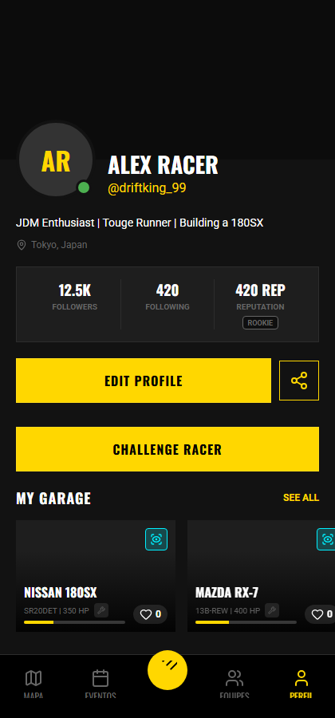
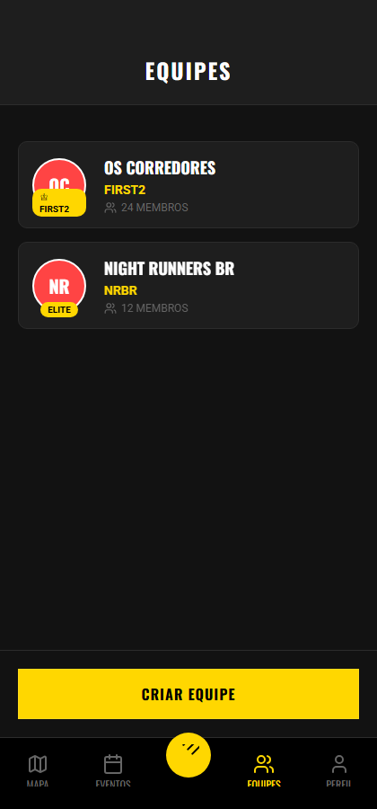
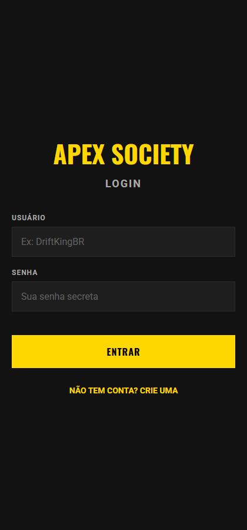
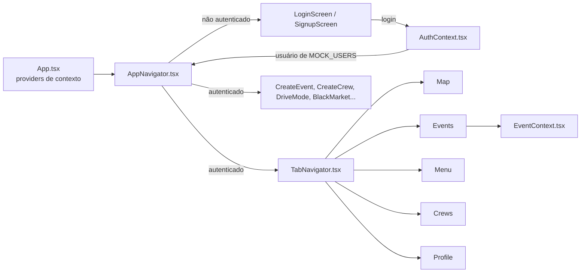

<div align="center">

# 🏔️ ApexSociety (Mobile)

**O app definitivo para entusiastas de carros e corridas underground, inspirado no FIRST2.**<br/>
Marque corridas de rua, eventos de carro e encontros automotivos, crie sua equipe e receba alertas de blitz, radar e acidentes em tempo real.

[](https://expo.dev/)
[](https://reactnative.dev/)
[](https://www.typescriptlang.org/)
[](https://juninmd.github.io/ApexSociety/)
[](package.json)


<br/>




[Versão web](https://juninmd.github.io/ApexSociety/) · [Tour](#-tour) · [Quick Start](#-quick-start) · [Como funciona](#-como-funciona) · [Roadmap](ROADMAP.md)

</div>

## 🌐 Live Web Version (Visualização Automática)

O aplicativo foi disponibilizado na web via **Netlify** e **GitHub Pages** para facilitar a visualização de encontros e equipes diretamente pelo navegador, sem necessidade de instalação!

- **[🚀 Acessar Versão Netlify](https://apexsociety.netlify.app/)** (Recomendado)
- **[Acessar Versão GitHub Pages](https://juninmd.github.io/ApexSociety/)**

> [!WARNING]
> Em 2026-10-23 o endereço do Netlify respondia 404 (site não encontrado) e o do GitHub Pages respondia 200. Use o GitHub Pages até o deploy do Netlify voltar.

_Os deploys para ambas as plataformas são configurados para atualizar automaticamente a cada push na branch `main`. Você também pode acionar o deploy manual para o Netlify rodando `pnpm run deploy:netlify` localmente após a build (`pnpm build:web`)._

## ✨ Features

- **Immersive Visuals**: High-fidelity UI with linear gradients and glassmorphism effects (Expo Blur).
- **Geospatial Intelligence**: Integrated maps and location services via `react-native-maps` and `expo-location`.
- **Custom Typography**: Premium font integration using Google Fonts (Oswald & Roboto).
- **Fluid Navigation**: Native-stack and bottom-tab navigation for a seamless user journey.
- **Strict Verification**: Type-checked and linted following Antigravity standards.

## 📸 Tour

Capturas da versão web (viewport 420x900) com os dados fictícios do próprio app.

<table>
  <tr>
    <td align="center" width="50%">
      <br/>
      <b>Mapa</b><br/>
      Botões de alerta Blitz, Radar e Acidente e o botão Offline Map (simulado).
    </td>
    <td align="center" width="50%">
      <br/>
      <b>Eventos</b><br/>
      Encontros e corridas com clima, risco, prêmio e check-in por geofence.
    </td>
  </tr>
  <tr>
    <td align="center" width="50%">
      <br/>
      <b>Equipes</b><br/>
      Lista de equipes e criação de nova equipe.
    </td>
    <td align="center" width="50%">
      <br/>
      <b>Perfil</b><br/>
      Estatísticas, reputação e garagem.
    </td>
  </tr>
</table>

<details>
<summary>Tela de login</summary>



</details>

## 🛠️ Tech Stack

- **Framework**: Expo 54 (React Native)
- **Styling**: Linear Gradient + SVG + Blur
- **Navigation**: React Navigation 7
- **Maps**: React Native Maps
- **State**: React Context / Hooks

## 🧩 Como funciona

`App.tsx` empilha os providers de contexto e monta o `AppNavigator`, que mostra Login/Signup até o `AuthContext` autenticar um usuário de `src/data/mock.ts`.



## 🚀 Quick Start

```bash
# Install dependencies
pnpm install

# Start the Expo development server
pnpm start

# Run on Android/iOS
pnpm android
pnpm ios
```

Na tela de login use `DriftKingBR` ou `SpeedDemon`. O login só confere o nome de usuário contra `MOCK_USERS`; não há backend e a senha não é validada.

## 🧰 Develop

```bash
pnpm install        # instala as dependências (pnpm 10)
pnpm start          # servidor de desenvolvimento do Expo
pnpm web            # versão web local (expo start --web)
pnpm type-check     # tsc --noEmit
pnpm lint           # eslint .
pnpm test           # jest
pnpm build:web      # exporta a versão web para dist/
pnpm test:e2e       # build web + Playwright em e2e/run-e2e.mjs, salva capturas em e2e/screenshots/
```

Variáveis de ambiente opcionais, lidas apenas pelos scripts de build:

| Nome                              | Propósito                                                               | Padrão                                      | Exemplo               |
| --------------------------------- | ----------------------------------------------------------------------- | ------------------------------------------- | --------------------- |
| `GH_PAGES`                        | Usa `/ApexSociety` como base da web (`app.config.ts`, `build:gh-pages`) | vazio (base `/`)                            | `GH_PAGES=true`       |
| `PUBLIC_URL` / `URL` / `HOMEPAGE` | URL pública usada em sitemap, `security.txt` e metadados HTML           | `homepage` de `src/constants/metadata.json` | `https://exemplo.com` |

## 🛡️ Antigravity Protocol

This project adheres to the **Antigravity** code standards:

- **150-Line Limit**: Mandatory for keeping UI components and logic hooks lean.
- **Strict Typing**: Full TypeScript coverage across all screens and services.
- **Pure Components**: Preference for functional components and specialized hooks.

## 🚧 Known limitations

- Os dados (usuários, eventos, equipes, garagem) vêm de mocks em `src/data/`; não há backend nem persistência.
- A versão web mostra uma tela de apresentação na aba Mapa (`MapScreen.web.tsx`); o mapa interativo com `react-native-maps` é do app nativo.
- `e2e/run-e2e.mjs` não faz login, então as capturas de Eventos, Equipes e Perfil que ele gera mostram a tela de login.
- Não há chamadas de rede em `src/`: os alertas de blitz, radar e acidente ficam em estado local (`HazardContext`), sem fonte em tempo real.

## 📄 License

MIT, conforme o campo `license` de `package.json`. O repositório ainda não tem um arquivo `LICENSE`.

---

_"Reach the peak of mobile excellence."_
